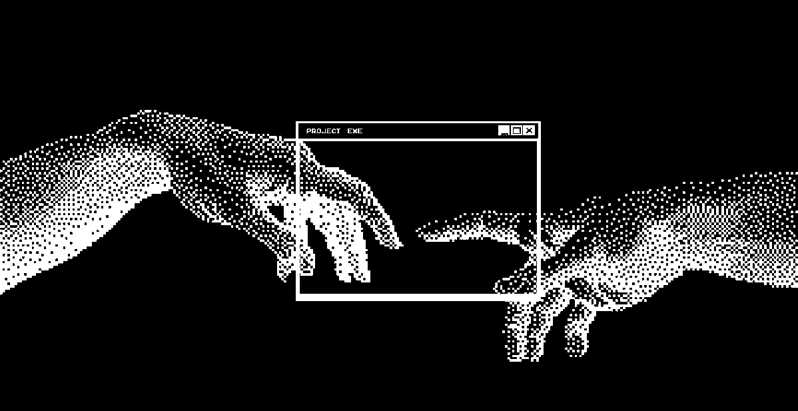
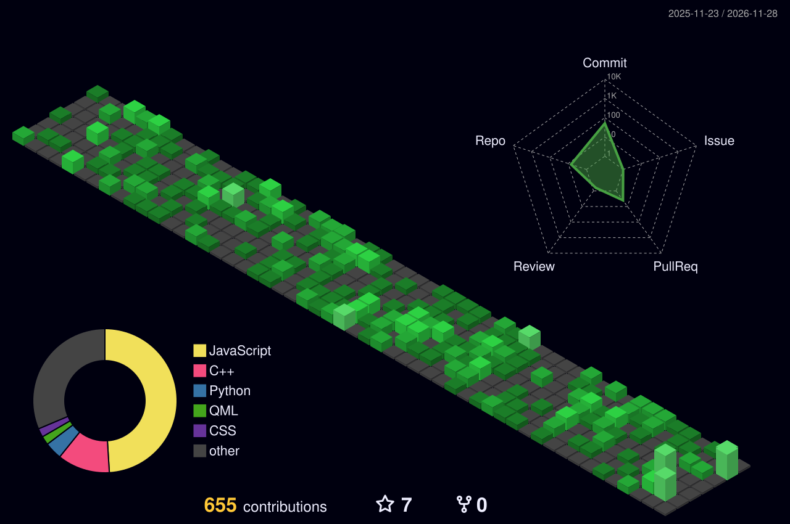

  

<h2 align="center">👋 Hi, I'm <a href="https://h7p5.github.io">Achraf</a>!</h2>

  

  
  &nbsp;
  
  &nbsp;
  
  &nbsp;
  

---

### About me

<table align="left">
  <tr><td>🎓 <b>Computer Science Student</b></td></tr>
  <tr><td>📍 Algeria 🇩🇿</td></tr>
  <tr><td>🛠️ <b>Currently building:</b> <a href="https://github.com/h7p5/chess-engine">chess engine</a> • Python tools</td></tr>
  <tr><td>🐧 <b>Environment:</b> <a href="https://archlinux.org">Arch Linux</a> + <a href="https://hyprland.org">Hyprland</a></td></tr>
  <tr><td>🔌 <b>Also:</b> Electronics with Arduino</td></tr>
  <tr><td>🌍 <b>Languages:</b> 🇩🇿 Arabic • 🇬🇧 English • 🇫🇷 French</td></tr>
</table>

  

 

---

  

<table align="center">
  <tr>
    <td valign="top">
      
    </td>
    <td valign="top">
      
    </td>
  </tr>
</table>

  

  

  

---

<h3 align="center">⚔️ Languages • Frameworks • Tools ⚔️</h3>

  

---

<h3 align="center">🚀 Featured Projects</h3>

<table align="center">
  <tr>
    <td align="center" width="50%">
      <a href="https://github.com/h7p5/chess-engine"><b>♟️ chess-engine</b></a> 
      A chess engine written in JavaScript. 
      <a href="https://h7p5.github.io/chess-engine/"><b>▶ Play it live</b></a>
    </td>
    <td align="center" width="50%">
      <a href="https://github.com/h7p5/insta-uploader"><b>📸 insta-uploader</b></a> 
      Upload Instagram Stories, Reels and Posts from Windows and Linux (Tkinter + instagrapi).
    </td>
  </tr>
</table>

---

<h3 align="center">🚧 Currently Working On</h3>

  ✅ Chess engine in JavaScript &nbsp;•&nbsp; ⬜ Python calculator &nbsp;•&nbsp; ⬜ Tic-Tac-Toe vs computer 
  ⬜ Password generator &nbsp;•&nbsp; ⬜ First documented Arduino project

---

<b>Made with ❤️ by <a href="https://github.com/h7p5">Achraf</a></b>

