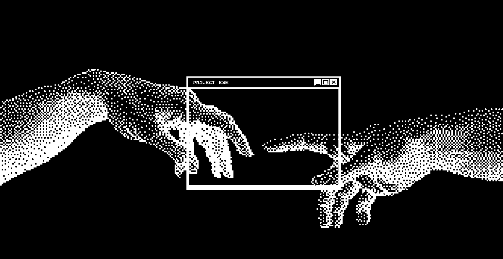

  

<h1 align="center">Hi 👋, I'm Achraf</h1>

<h3 align="center">Future Computer Science Student</h3>

  

Building small, useful projects and learning something new every day.

---

<h2 align="center">🚀 About Me</h2>

**Achraf** here, a final-year high school student from 🇩🇿 **Algeria** (Experimental Sciences), preparing to study **Computer Science**.

I'm building my first projects in **Python** and learning **C++** and **JavaScript**. I also play with electronics on **Arduino**.

♟️ Chess player: I love problems that need strategy and logic. 
💪 Calisthenics: discipline every day, in training and in code. 
🌍 Arabic • English • French (learning)

My goal is simple: write clean code, keep learning, and grow into a software engineer who builds things that last.

 

---

<h2 align="center">🤝 Connect</h2>

  
  &nbsp;
  
  &nbsp;
  

---

<h2 align="center">💻 Tech Stack</h2>

  
   
  

---

<h2 align="center">♟️ Featured Project</h2>

  <a href="https://github.com/h7p5/chess-engine"><b>h7p5/chess-engine</b></a> 
  A chess engine written in JavaScript. <a href="https://h7p5.github.io/chess-engine/"><b>▶ Play it live</b></a>  
  

---

<h2 align="center">🚧 Currently Working On</h2>

- [x] Chess engine in JavaScript
- [ ] Python calculator
- [ ] Tic-Tac-Toe game with a computer opponent
- [ ] Password generator
- [ ] First documented Arduino project

---

<h2 align="center">📊 GitHub Stats</h2>

  
  

---

<h2 align="center">📈 Activity Graph</h2>

  

